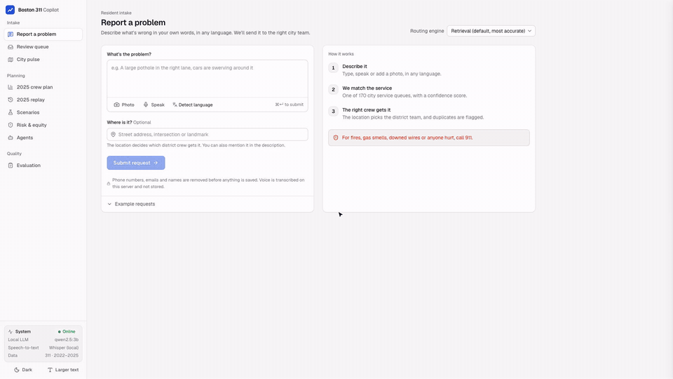

# Boston 311 Copilot

**Route every request right, then staff for it.**

> Hackathon submission for **IE5374 16753 ST: Applied Generative AI**, Northeastern University. **Team 4:**
> Parth Sanjay Saraykar, Rutuja Kalidasrao Jadhav, Samruddhi Bansod.

## Demo video (3 min)

<a href="media/boston-311-copilot-demo.mp4"></a>

▶ **[Watch the full demo with narration](media/boston-311-copilot-demo.mp4)** (2:55, 1080p). The animation above is a silent 30-second preview. It covers resident intake in any language
and by voice, the 911 safety gate, the 2025 crew plan, "Ask the plan", the agents, the 2025 replay on real data,
City pulse and the evaluation. The video is recorded straight from the running app with `make video`.

## What it is

One app with two halves:

- **Resident side.** A plain-language complaint (any language, optional photo or voice; voice is transcribed by a local
  Whisper model, so it works in every browser) goes to the right one of the
  **170 type / department / queue combinations** in Boston's 311 data. It comes with a confidence score, a map pin and
  nearby open reports. Emergencies get a red *Call 911* banner, and anything off-topic or manipulative is refused.
- **Planner side.** The cheapest month-by-month **2025 crew plan** for Public Works, Transportation, Parks and
  Inspectional Services: hires, releases and Parks seasonal crews. It comes with sensitivity analysis, 100 simulated
  demand years and four agents that explain, stress-test and monitor the plan.

All of it runs on a laptop, with free local models through **Ollama**. Every LLM feature also has a fallback that
needs no LLM, so the demo works even with Ollama off.

## Results (real Boston 311 data, 2022–2025)

| | |
|---|---|
| Optimised plan, 2025 | **$17.34M**, **92.5%** of requests closed within the month (≥85% in every department) |
| Flat staffing (today's crews all year) | $19.46M, 75.2% on time → **saves $2.13M** |
| **2025 replay** (real demand, month by month) | optimised plan + monitor: **$17.86M, 89.5% on time** vs today's crews $18.39M, 78.5% (Transportation 45% → 98%); a never-changed plan leaves Inspectional Services at 71% |
| Forecast, 2025 holdout | Transportation 4.7% WAPE, Inspectional Services 6.1%, Public Works 19.7%, Parks 42.4% (Parks volume really fell 26% in 2025) |
| Intake, 201 hand-labelled messages | retrieval: **94% type / 97% department** accuracy (TF-IDF baseline 83%; 90% on messages that aren't near-copies of card examples). The local `qwen2.5:3b` LLM scored **82% / 89%**, so retrieval is the default router |
| Safety | **100%** of emergencies caught, 0 false alarms; 100% of injection / off-topic refused |
| Queue from location (286 real 2025 cases) | 83% exact queue, 96% department |

See `report/report.md` for method, results and limits.

## Run it

```bash
make setup                    # Python venv + web deps (Intel Mac pins: torch 2.2 / numpy 1.x)
make data                     # download 311 CSVs 2022-2025 from data.boston.gov (~680 MB)
make all                      # pipeline -> forecast -> plan -> scenarios -> replay -> eval  (about 4 minutes)
make web && make api          # app + UI on http://localhost:8000
```

`make dev` runs the API on :8000 and the Vite dev server on :5173 together. `make test` runs the pytest suite.

**Local LLM (optional, free).** Install [Ollama](https://ollama.com/download), then `make models` pulls
`qwen2.5:3b` (classifier and agents) and `moondream` (photos). The header shows "Local LLM ready" once they're in.
On a CPU-only laptop a classification takes about 20 s, so:
- the Resident tab defaults to **Retrieval**, which answers in under 100 ms and was the most accurate in our tests;
- **Local LLM (demo cache / live)** is a switch; `make demo-cache` pre-runs the demo inputs so they come back
  instantly;
- `make eval-llm` runs the full LLM evaluation (about 1 hour; it resumes if stopped).

**Voice input.** The page records audio, converts it to 16 kHz WAV and posts it to `POST /intake/transcribe`.
There, `faster-whisper` (`small` by default, `WHISPER_MODEL` to change) transcribes it in about 4 s on CPU, in a
separate worker process. Audio is never stored. The microphone needs `localhost` or HTTPS; on a phone over plain
http the browser blocks it, and the page says so.

**Docker.** `docker compose up` starts Ollama and the app (UI + API) on :8000. Build the data on the host first
(`make data all`); it is mounted in.

**Share a public link.** With the API running, `make share` opens a free Cloudflare quick tunnel and prints an
`https://….trycloudflare.com` link. The Review page's QR code switches to it, so judges can file from their phones,
mic included. Visitors arriving through the tunnel are in **public mode**: they can file requests and browse, but
approvals, review decisions, agents and the local LLM only work on the host laptop. Inputs are size-capped and
rate-limited to 20 a minute per visitor. Ctrl+C stops sharing.

**Demo video.** `make video` (with `make api` running) drives the real app in Chrome through the demo, with a
visible cursor, captions and narration, and writes `video/out/boston-311-copilot-demo.mp4`. Narration uses
[Kokoro](https://github.com/thewh1teagle/kokoro-onnx), an open-source neural voice run locally. Set it up once with
`python3 -m venv video/.tts && video/.tts/bin/pip install kokoro-onnx soundfile`, then download
`kokoro-v1.0.onnx` and `voices-v1.0.bin` into `video/models/`. Without it the video falls back to the macOS
voice. Options: `NARRATOR=am_michael`, `SPEED=1.05`.

**MCP.** `make mcp` serves the same tool registry the agents use over MCP (stdio), so Claude Desktop or any MCP
client can call `get_plan`, `explain_month`, `run_scenario` and the rest.

## Architecture

```
            Resident (text / photo / voice)                         Planner
                        │                                              │
   ┌────────────────────▼───────────────────┐        ┌────────────────▼──────────────────┐
   │ intake/  safety gate → privacy scrub →  │        │ forecast/  seasonal-naive vs ETS   │
   │ photo (moondream) → retrieve top-10 of  │        │   backtest 2024, holdout 2025      │
   │ 72 type cards (multilingual MiniLM +    │        │ optimizer/ integer program (CBC):  │
   │ TF-IDF) → classify (qwen2.5, JSON       │        │   crews, hires, releases, Parks    │
   │ schema) → Pydantic → clarify if <0.6 →  │        │   seasonals; LP duals = shadow $   │
   │ geocode → neighborhood → queue          │        │ scenarios/ locked vs re-planned,   │
   └────────────────────┬───────────────────┘        │   storm, 100 years, robust, tornado│
                        │ filed request +1             └────────────────┬──────────────────┘
                        ▼                                              │
              SQLite: intake log (scrubbed), live demand,  ◄───────────┘
              agent traces, proposals, review queue
                        │
   agents/tools.py — ONE tool registry (also served over MCP)
   Intake · Planner · Stress-test · Monitor agents = system prompt + tool allowlist + step limit
   run_agent(): Ollama tool calls, every number checked against tool output, else scripted policy
   propose_plan writes a draft only; a person clicks Approve → POST /plan/approve/{id}
                        │
                 api/main.py (FastAPI) ── web/ (React, Tailwind, Recharts, Leaflet)
```

## Repo layout

| Folder | What's in it |
|---|---|
| `data/` | `download.py`, `pipeline.py` (DuckDB → parquet: monthly, daily, catalog, equity, geo points, open cases) |
| `forecast/` | `model.py`: models, backtests, p10/p90 band, residuals |
| `optimizer/` | `model.py` (`solve`, `simulate`), `run.py` (calibration, baselines, frontier, history check) |
| `scenarios/` | `scenario.py`: locked vs re-planned, storms from real data, Monte Carlo, robust plan, smoothing, tornado |
| `intake/` | cards (`cards_source.yaml`, hand-written), retrieval, safety + privacy, classifier, geo |
| `agents/` | tool registry, `run_agent` runtime, the four agents, MCP server, PDF memo |
| `api/` | FastAPI endpoints |
| `web/` | Resident, Planner and Evaluation tabs |
| `contracts/` | JSON schemas + the real output files the UI reads |
| `eval/` | labelled test set (`build_testset.py`), `run_eval.py`, `eval.json`, per-case results |
| `report/` | report, model card, slide outline, demo script |
| `video/` | `make_video.mjs` (records the demo from the live app), `tts.py` (Kokoro narration) |
| `media/` | the demo video and its thumbnail |
| `params.yaml` | every planning input, marked **brief** or **assumed** |

## Endpoints

`POST /intake/classify` · `GET /intake/live` · `GET /forecast` · `GET /plan` · `POST /plan/solve` ·
`GET /plan/baselines` · `GET /plan/frontier` · `POST /scenario` · `GET /scenarios` · `POST /agent/ask` ·
`POST /agent/intake` · `POST /agent/stress-test` · `POST /agent/monitor/run` · `GET /agent/trace/{run_id}` ·
`GET /proposals` · `POST /plan/approve/{id}` · `POST /plan/reject/{id}` · `GET /eval` · `GET /eval/cases` ·
`GET /review-queue` · `GET /equity` · `GET /monitor/quality` · `GET /memo.pdf` · `GET /health`
